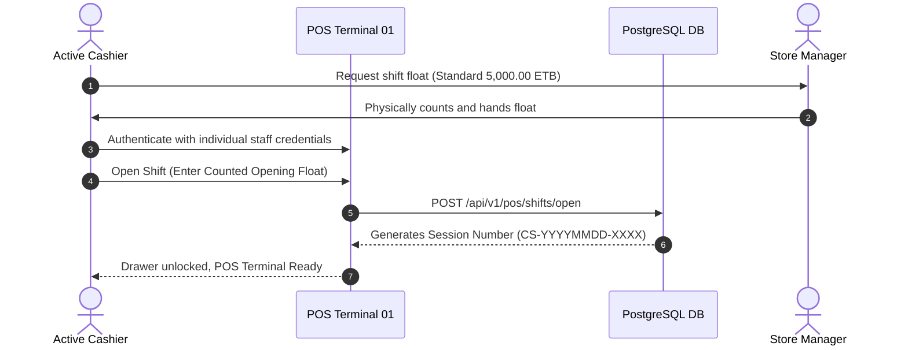
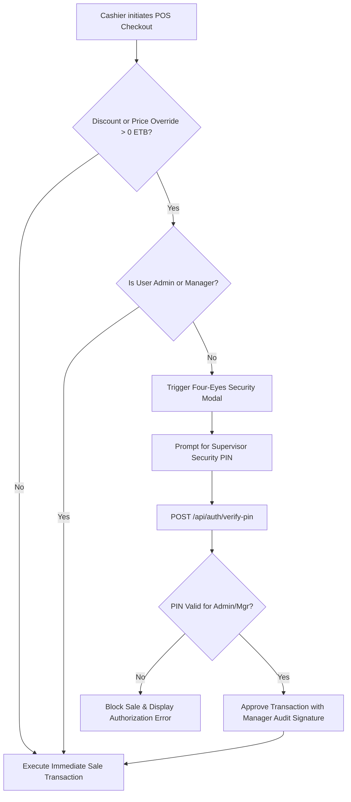

# Standard Operating Procedure (SOP): Retail Operations & Zero-Theft Audit Protocols
**Nasir Amme Electronics — Dire Dawa, Ethiopia**

---

## 1. Document Overview & Enterprise Scope

- **Organization:** Nasir Amme Electronics
- **Store Location:** Dire Dawa, Ethiopia (Kebele 02, Commercial District)
- **Primary Branch ID:** `DD-MAIN-01`
- **System Currency:** Ethiopian Birr (ETB)
- **Timezone Standard:** `Africa/Addis_Ababa` (UTC+3, East Africa Time — EAT)
- **Effective Version:** Production 2026.4
- **Audience:** Store Administrators, Branch Managers, Cashiers, Stock Keepers, Internal Auditors

---

## 2. Core Operational Principles

1. **Zero Internal Shrinkage:** All material items entering or leaving the retail perimeter must have an immutable, cryptographically signed ledger movement.
2. **Four-Eyes Principle:** No cashier may unilaterally discount items, override selling prices, or void transactions without secondary authorization from an authorized Store Manager or Administrator PIN.
3. **Serialized Custody (IMEI/Serial Tracking):** High-value electronics (Apple AirPods, Anker power banks, JBL audio, smartphones) must be assigned unique serial numbers at dock intake, strictly tracked across stock movements, and retired atomically upon customer checkout.
4. **Blind Shift Drops:** Cashiers must close their registers with a blind physical count of banknotes. The system independently computes drawer variance without displaying expected totals in advance.
5. **Month-End Reconciliation:** Unresolved drawer shortages are permanently logged to employee shift records and reconciled prior to monthly payroll disbursement.

---

## 3. Shift Opening Protocol



### Steps:
1. **Physical Handover:** The shift supervisor issues the physical cash float (e.g. 5,000.00 ETB or 12,400.00 ETB) from the store safe.
2. **Staff Login:** The cashier logs into `http://localhost:3000/login` using their unique staff email (e.g. `tigist@amme-electronics.et`) and secure password. Shared passwords (`Amme@2026`) are strictly forbidden and blocked.
3. **Register Initialization:** If no session is open, the POS terminal prompts for the opening float amount.
4. **Audit Record:** A new record is created in `cash_sessions` with `status: 'open'`, timestamped in `Africa/Addis_Ababa` time.

---

## 4. Inbound Stock Receiving & Serial/IMEI Intake

**Console Route:** `/inventory/intake`  
**Authorized Roles:** Store Administrator, Store Manager, Stock Keeper (`Abel Kebede`)

### A. Purchase Order (PO) Inbound Receiving
1. Navigate to `/inventory/intake` and select the **PO Inbound Receiving** tab.
2. Select the pending Purchase Order from the dropdown (e.g., `PO-2026-0041` from Anker Official East Africa).
3. Verify physical package seals against line item quantities.
4. For serialized items (`hasSerials: true`), the intake console requires scanning or entering matching serials/IMEIs (e.g., `SN-ANK-20K-0841`).
5. Click **Confirm Inbound Intake**.
6. The system atomically:
   - Updates `purchase_orders.status` to `'received'`.
   - Increments product cached stock `onHand` and `stockQuantity`.
   - Inserts records into `product_serials` with `status: 'in_stock'`.
   - Records an immutable row in `stock_movements` (`movementType: 'purchase_receive'`).

### B. Direct Counter / Dock Receiving
1. Select the **Direct Intake** tab.
2. Pick the incoming SKU from catalog search.
3. Enter received quantity and unit cost price in ETB.
4. Scan or type IMEIs into the serial tag input.
5. Submit to automatically recalculate the **Moving Weighted-Average Cost**:
   $$\text{New Average Cost} = \frac{(\text{Current On-Hand} \times \text{Current Average Cost}) + (\text{Incoming Qty} \times \text{Incoming Unit Cost})}{\text{Current On-Hand} + \text{Incoming Qty}}$$
6. Click **Print Intake Labels** to produce thermal shelf barcode tags.

---

## 5. POS Counter Checkout & Multi-Rail Tender Processing

**Console Route:** `/pos`  
**Authorized Roles:** Store Administrator, Store Manager, Cashier (`Tigist Hailu`)

### A. Item Ring-up & Hardware Barcode Scanning
- Use the USB/Bluetooth HID Barcode Scanner to scan retail barcodes.
- The system automatically adds items to the active cart.
- Real-time stock boundaries are enforced: an item cannot be rung up if quantity exceeds physical store balance.

### B. Serialized Custody Capture
- When adding serialized electronics (AirPods, JBL speakers, smartphones), the **Serialized Custody Modal** appears.
- The cashier scans the unit's manufacturer barcode or selects from pre-registered in-stock serial numbers.
- Unserialized checkout of serialized SKUs is strictly blocked.

### C. Multi-Rail Tender Handling

| Tender Rail | Method Code | Operational Requirement |
| :--- | :--- | :--- |
| **Telebirr** | `telebirr` | Verify customer USSD / SuperApp transaction confirmation screen; enter 8-character Transaction Reference. |
| **CBE Birr** | `cbe_birr` | Verify SMS receipt from Commercial Bank of Ethiopia (127); input transfer reference. |
| **Cash Till** | `cash` | Enter physical cash tendered in ETB; verify authentic Ethiopian banknotes (10, 50, 100, 200 ETB); dispense exact change. |
| **Bank Invoice** | `bank_transfer` | Verify bank slip / wire transfer confirmation for B2B or wholesale purchases; input wire reference. |
| **Store Credit** | `credit` | Only allowed for vetted business counterparties linked in `customers` table. |

### D. ESC/POS Thermal Receipt Issuance
- Upon tender completion, the system automatically prints an 80mm ESC/POS thermal receipt containing:
  - Header: Store Name, Dire Dawa Address, TIN (`DEMO-TIN-0049281734`), Primary Phone (`+251 915 00 11 22`).
  - Body: Sequential Receipt Number (`REC-YYYY-XXXX`), Date & Time (EAT), Cashier Name, Customer Name.
  - Line Items: Item Name, SKU, Serial Number / IMEI tags, Quantity, Unit Price, Line Total.
  - Financials: Subtotal, Discount, VAT (0.00%), Grand Total in ETB.
  - Tender summary: Cash Tendered, Change Given, or Electronic Reference.
  - Footer: 3-day return policy and manufacturer warranty terms.

---

## 6. Four-Eyes Principle Manager PIN Authorization



- When a cashier attempts to discount a sale, the **Four-Eyes Authorization Modal** locks the register.
- A Store Manager (e.g. `Yonas Bekele`) or Administrator (e.g. `Nasir Amme`) must enter their authorized 4-digit PIN (default: `1234`).
- The system verifies the cryptographic bcrypt hash against active management accounts.
- The transaction record in `sales` and `audit_logs` permanently records the approving supervisor.

---

## 7. Shift Closing & Blind Cash Register Drops (Z-Report)

1. At the conclusion of the cashier's shift, the cashier clicks **Close Shift (Z-Report)**.
2. The **Blind Cash Drop Modal** is presented.
3. **Anti-Theft Directive:** The cashier is **NEVER** shown expected cash totals. They must count all physical ETB banknotes in the till drawer and input the counted sum.
4. Click **Submit Blind Count & Lock Shift**.
5. The backend executes `CashSessionService.closeSession` in a row-locked transaction:
   $$\text{Expected Cash} = \text{Opening Float} + \sum \text{Cash Sales} - \sum \text{Cash Refunds}$$
   $$\text{Net Variance} = \text{Closing Cash Counted} - \text{Expected Cash}$$
6. **Classification:**
   - **Balanced ($0.00\text{ ETB}$):** Shift closed with perfect balance.
   - **Overage ($> 0.00\text{ ETB}$):** Credited to unallocated shop reserve.
   - **Shortage ($< 0.00\text{ ETB}$):** Flagged in red, written to `cash_sessions.cashDifference`, and logged to the cashier's monthly reconciliation profile.

---

## 8. Month-End Payroll & Shortage Settlement Procedure

1. Prior to monthly payroll calculation (28th of each calendar month), the Branch Manager generates the **Cashier Drawer Variance Report** from `/admin/dashboard`.
2. All shifts for the month are filtered by `cashierId`.
3. Total cumulative shortage for each employee is calculated:
   $$\text{Cumulative Shortage} = \sum_{\text{month}} |\min(0, \text{cashDifference})|$$
4. Under Nasir Amme Electronics company policy:
   - An allowance of up to $150.00\text{ ETB}$ per month is permitted for genuine coin rounding.
   - Cumulative shortages exceeding $150.00\text{ ETB}$ require formal review by Nasir Amme.
   - Unexplained material cash or serialized stock discrepancies are recovered via payroll deduction before net salary disbursement.
5. All monthly reconciliation summaries must be co-signed by:
   - **Nasir Amme**, Managing Director & Founder
   - **Yonas Bekele**, Store Operations Manager
   - **Active Cashier**, Employee Acknowledgment

---

## 9. Verification & Automated Test Commands

To guarantee ongoing compliance with this SOP, technical staff must run the automated verification test suites before any software deployment:

```bash
# 1. Audit & Anti-Theft Verification (Boundaries, Serials, Blind Drops, Four-Eyes PIN)
npm run test:audit

# 2. Executive Operations Dashboard & Financial Math
npm run test:dashboard

# 3. Role-Based Access Control & Permission Boundaries
npm run test:rbac

# 4. TypeScript Strict Static Type Checking
npx tsc --noEmit
```

*All tests must yield 100% pass rates prior to retail store opening.*
